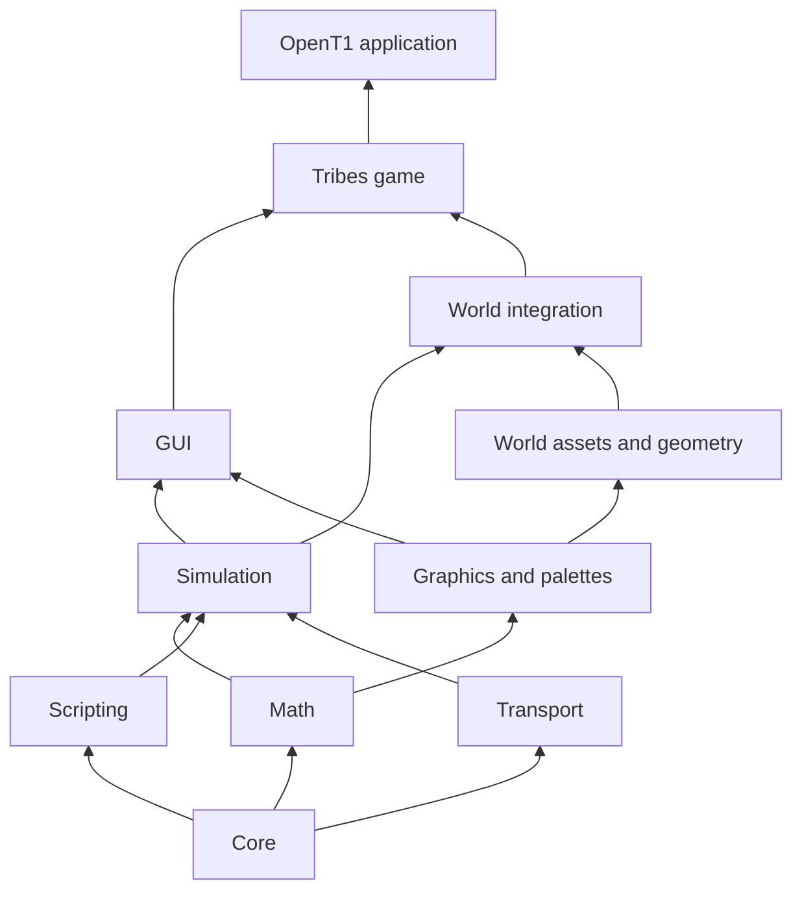

# Architecture

OpenT1 implements engine services and Tribes game systems. Its libraries
follow dependency layers: core services support the simulation,
asset and rendering systems, and the game composes them into a client/server
application. Public interfaces are under `include/opent1/<subsystem>/` and
implementations under `src/<subsystem>/`.

The target definitions in `CMakeLists.txt` determine which libraries and native
adapters are included in a build.

## Modules

| Area | Main targets | Responsibility |
| --- | --- | --- |
| Core | `opent1_core` | Fixed-width types, streams and bitstreams, compression, VOL archives, resources, persistence, timers and threading |
| Math | `opent1_math` | Vectors, matrices, rotations, collision primitives, deterministic numeric helpers |
| Scripting | `opent1_console` | Tags, lexer/parser, script evaluation, commands and bound variables |
| Transport | `opent1_net` | UDP, loopback, optional OS-provided IPX, connection protocol, and TCP services |
| Platform | `opent1_platform` | SDL3 windows, event translation and application callbacks |
| Simulation | `opent1_sim` | Object ownership, groups/sets, events, world services, network replication and inspection |
| Graphics | `opent1_palette`, `opent1_gfx` | Palettes, bitmaps/fonts, indexed software drawing, texture caches and hardware batches |
| World | `opent1_world` | TS shapes, terrain/interior formats, collision, lighting and authoring |
| World integration | `opent1_world_sim` | Resource-backed scenes, missions, world queries, movement and terrain editing |
| GUI | `opent1_gui`, `opent1_gui_world` | Retained controls, layout, input routing, dialogs and editor tools |
| Audio | `opent1_audio`, `opent1_audio_sim`, `opent1_world_audio` | Wave resources, OpenAL playback, positional voices and simulation sound markers |
| Video | `opent1_video`, `opent1_video_sdl` | Bounded Smacker decoding, clocked playback, GPU/audio adapters |
| Game | `opent1_game` | Tribes datablocks, sessions, players, weapons, vehicles, AI, HUD, shell and application lifecycle |
| Application | `opent1` | Standalone executable and command-line entry point |

Targets ending in `_sdl` connect portable services to native presentation.
`opent1_sim_gfx` adapts simulation rendering to the graphics interfaces;
`opent1_gfx_sdl` submits graphics through SDL_GPU. GUI native hosts are in
`opent1_gui_tools_sdl`. CMake links these adapters into the game when their
corresponding features are enabled.

## Dependency direction

Arrows point from a dependency to its consumer. The diagram omits optional
presentation/media adapters. Core formats, script execution, transports,
simulation and software rendering can build without SDL3 or OpenAL.

## Application flow

`src/main/main.cpp` provides the standalone entry point and the shared
`runFearMain` runtime. `FearGameApp` creates the console, resource manager,
plugins and server/client worlds. An explicit asset root or installation
discovery supplies search directories and mounted VOL archives. When volumes
are mounted, normal startup evaluates `console.cs`; `--spawn-demo` selects a
small built-in simulation instead. Required startup-script failures stop
initialization. See the [runtime reference](runtime.md) for the launch options
and data paths.

The standalone SDL executable runs through SDL application callbacks, including
when `--headless` suppresses window creation. The build without SDL uses a
bounded fallback loop. Embedded callers of `runFearMain` also use that fallback
when they pass `--headless`. These are distinct execution paths.

A frame processes input and transport events, advances the simulation and
player prediction, updates world state, gathers visible scene objects, and
draws the world and GUI. Presentation and audio update through the enabled
adapters. SDL interactive frames use elapsed wall time; smoke and explicitly
bounded runs supply 32 ms frame times. The fallback loop always supplies 32 ms
frame times. `FearGameApp::stepFrame` delegates simulation advancement to
`SimGame`, and rendering consumes the resulting state. Shutdown disconnects
sessions, unregisters services, and releases world and native resources.

## Resources and rendering

`ResourceManager` resolves names through configured directories and mounted
archives. Registered loaders decode typed resources such as bitmaps, palettes,
fonts, TS shapes/material lists, terrain, interiors, and movies. Scene adapters
combine those resources with simulation objects, transforms, animation state,
collision providers, and lighting. Mission loading attaches the resulting
objects and services to the appropriate world.

The software path draws indexed pixels into `SoftwareSurface`, preserving
palette, shade, haze, transparency, and font operations. The hardware path
collects CPU-side `HardwareBatch` geometry and materials and submits them through
`SdlGpuSurface`. SDL_GPU presents both hardware output and expanded software
frames. GUI controls share bitmap/font primitives and have adapters for SDL
input and presentation.

GPU shaders are embedded at configuration time from committed SPIR-V, DXIL, and
Metal source files. Normal builds do not run a shader compiler. Shader changes
must keep those representations aligned; see [development](development.md).

## Ownership and state

- `SimManager` owns registered simulation objects. `SimGroup` expresses a
  single parent relationship; additional `SimSet` memberships borrow objects.
  Deletion during callbacks is deferred until the callback scope is safe.
- Resource managers own/cache loaded resources. Typed resource handles and
  shared immutable shape/render snapshots allow consumers to retain data
  across scene changes without borrowing freed storage.
- Each console owns its scopes, command registry, function syntax trees,
  tags and log. Independent instances can run concurrently; a shared console
  and shared resource managers need external synchronization. Bound references
  must outlive their use. File logging and exports can address the same filesystem
  paths across instances, so callers must coordinate those outputs as well.
- Transport sessions borrow their transports and run on the owner thread.
  Received events own their payloads. Backpressure and failures are explicit
  results that the caller handles on a later tick.
- Windows, GPU objects, audio devices and streams have explicit lifecycle
  owners. Simulation modules depend on service interfaces rather than device
  handles.

## Compatibility boundaries

Asset files and network messages use fixed-width values and explicit stream
operations. Native object sizes and pointer widths are not wire formats.
Loading and update paths validate sizes, counts and truncation before publishing
state. The regression suite checks selected format and 1.11 behaviors; passing
it does not establish exhaustive compatibility with every installation or peer.

The networking stack has two levels: datagram/session transport in
`opent1::net`, and packet streams, replicated events, and ghost objects in
`opent1::sim`. The game adds datablocks, connection handshakes, player
control/prediction, and game-specific updates. See
[simulation networking](simulation-networking.md).

Most code is C++20. MSVC x64 additionally builds `src/math/x87_x64.asm` to
preserve selected x87 floating-point behavior; other configurations use
the portable implementations. The CI workflow configures Windows x64, Linux
x64, and macOS ARM64 desktop and headless builds. This configuration is distinct
from interactive graphics, audio-device, or live-server validation.

## Tests and extension points

One `opent1_tests` binary registers cases by subsystem, and CTest invokes each
suite with an isolated working directory. A separate runtime smoke check runs
the actual application without external assets. See [development](development.md).

Add portable behavior to the lowest applicable library, connect native services
through the existing adapters, and put game-specific rules in `opent1_game`.
Use explicit stream serialization when extending a persisted or networked type.
